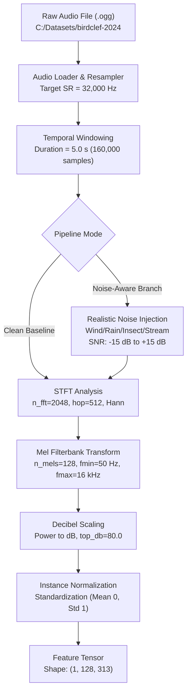

# Project Architecture: Acoustic Bird Biodiversity Research

## 1. Fixed Research Question
> **“How does realistic environmental noise affect bird species classification, and to what extent can noise-aware training improve the robustness and reliability of acoustic biodiversity monitoring?”**

This architecture is deliberately designed to provide rigorous experimental control, reproducible acoustic signal pipelines, and isolated benchmarks for evaluating deep learning model degradation and robustness under realistic environmental noise profiles.

---

## 2. Directory Layout & Subsystem Responsibilities

```text
C:/projects/bird-biodiversity-research/
│
├── configs/                     # Centralized experiment & pipeline configurations
│   └── config.yaml              # Canonical baseline parameters & data root
│
├── data/                        # Local data management (strictly decoupled from raw audio)
│   ├── raw/                     # Read-only reference stubs (actual raw audio resides externally)
│   ├── processed/               # Cached Mel-spectrograms, pre-extracted features, embeddings
│   └── manifests/               # Deterministic CSV manifests, cross-validation splits, label maps
│
├── src/                         # Core Python package implementing modular research logic
│   ├── __init__.py              # Package root
│   ├── utils/                   # Configuration parsing, logging, seeding, system utilities
│   │   ├── __init__.py
│   │   ├── config.py            # Validated YAML configuration loader
│   │   ├── seed.py              # Cross-framework deterministic seed setter
│   │   └── logger.py            # Structured research logger
│   ├── audio/                   # Acoustic signal processing & feature transforms
│   │   ├── __init__.py
│   │   └── processor.py         # Audio normalization, resampling, Mel-spectrogram computation
│   ├── data/                    # Dataset loaders, manifest generators, PyTorch Datasets
│   │   └── __init__.py
│   ├── models/                  # Deep neural network backbones, heads, and pooling layers
│   │   └── __init__.py
│   └── evaluation/              # Metrics calculation (Macro ROC-AUC, F1, calibration, SNR curves)
│       └── __init__.py
│
├── notebooks/                   # Interactive exploratory data analysis & diagnostic notebooks
├── scripts/                     # Standalone CLI tools (manifest generation, feature precomputing)
├── experiments/                 # Experiment execution configs, run checkpoints, tracking logs
├── models/                      # Saved checkpoint weights, best model weights, exported formats
├── reports/                     # Generated scientific outputs & publications
│   ├── figures/                 # Spectrogram figures, SNR degradation curves, confusion matrices
│   └── results/                 # Evaluation metric tables, ablation CSVs, calibration reports
├── docs/                        # Research documentation, methodology notes, scientific plan
│   └── research_plan.md         # Full research plan and formal hypotheses
├── tests/                       # Unit and integration test suites
│   ├── __init__.py
│   └── test_config.py           # Verification of configuration schema, paths, and reproducibility
├── app/                         # Biodiversity monitoring inference interface / dashboard demo
│
├── README.md                    # Project overview, installation, and research summary
├── requirements.txt             # Pinned and bounded Python package dependencies
├── .gitignore                   # Version control ignore rules (protects large audio/model binaries)
└── PROJECT_ARCHITECTURE.md      # This architectural specification document
```

---

## 3. Acoustic Processing Pipeline Architecture

All acoustic processing adheres to controlled baseline values defined in [`configs/config.yaml`](file:///C:/projects/bird-biodiversity-research/configs/config.yaml):



### Initial Baseline Acoustic Constants
| Parameter | Canonical Value | Scientific Justification |
| :--- | :--- | :--- |
| **Sample Rate** | `32,000 Hz` | Preserves Nyquist frequency at 16 kHz, capturing high-frequency bioacoustic harmonics while minimizing storage. |
| **Clip Duration** | `5.0 s` | Standard BirdCLEF temporal window; aligns with soundscape evaluation chunks. |
| **Target Samples** | `160,000` | Exact sample count ($32,000 \times 5.0$). Zero-padded or randomly cropped for training. |
| **FFT Size (`n_fft`)** | `2048` | Frequency resolution of $\Delta f \approx 15.625\text{ Hz}$ (~64 ms temporal window). |
| **Hop Length** | `512` | Time resolution of $\Delta t = 16\text{ ms}$ (75% overlap, 313 time frames per 5s). |
| **Mel Filterbanks (`n_mels`)**| `128` | Perceptually scaled logarithmic frequency resolution capturing avian vocalization envelopes. |
| **Frequency Range** | `50 Hz - 16,000 Hz` | Eliminates sub-audible low-frequency microphone wind rumble (<50 Hz) while preserving avian vocal range. |
| **Random Seed** | `42` | Strictly controls pseudo-random number generation across Python, NumPy, and PyTorch. |

> **Crucial Rule**: These initial research values establish the baseline standard. Any change must be executed exclusively through controlled experiments with recorded ablation metrics.

---

## 4. External Dataset Governance Protocol

```text
External Dataset Storage:
C:/Datasets/birdclef-2024/
├── train_audio/           # 24,459 OGG recordings across 182 avian species
├── train_metadata.csv     # Primary species labels, latitude/longitude, recording authors
├── test_soundscapes/      # Continuous field soundscapes for benchmark evaluation
├── eBird_Taxonomy_v2021.csv # Taxonomic hierarchy and scientific nomenclature
└── sample_submission.csv  # Target evaluation schema
```

### Security & Integrity Directives:
1. **Read-Only Access**: All dataset reading operations are performed in read-only mode (`r` or binary `rb`). No files within `C:/Datasets/birdclef-2024` may be modified, created, or deleted.
2. **Decoupled Manifests**: Instead of copying audio, the pipeline generates lightweight manifest files in `data/manifests/` storing relative audio paths, duration, verified label vectors, and stratified split partitions.
3. **No Redundant Downloads**: No secondary copies or subsets of the dataset shall be downloaded or committed to version control.

---

## 5. Noise Simulation & Robustness Evaluation Strategy

To answer the fixed research question, the architecture provides a dedicated noise simulation engine:
- **Noise Classes**:
  1. *Wind / Hydrodynamic Turbulence*: Low-frequency, non-stationary burst energy.
  2. *Rainfall / Hydroacoustic Noise*: Wideband acoustic veil masking mid-to-high frequencies.
  3. *Insect Stridulation (Orthoptera / Cicadoidea)*: High-frequency narrowband harmonic interference (4 kHz - 12 kHz).
  4. *Stream / Fluvial Noise*: Continuous pink-noise-like masking.
  5. *Anthropogenic Interference*: Vehicle engines, mechanical impulses.
- **Controlled SNR Regimes**:
  - Training noise injection: random SNR uniformly sampled from $[-15\text{ dB}, +15\text{ dB}]$ with probability $p=0.5$.
  - Evaluation protocol: fixed evaluation grid at $\{-15, -10, -5, 0, +5, +10, +15\}\text{ dB}$ plus clean control ($\infty\text{ dB}$).
- **Evaluation Criteria**:
  - Degradation slopes: $\Delta \text{ROC-AUC} / \Delta \text{SNR}$.
  - Expected Calibration Error (ECE) under noise corruption.
  - False positive proliferation rates on background-only audio.

---

## 6. Reproducibility & Seed Governance

A dedicated seeding module ([`src/utils/seed.py`](file:///C:/projects/bird-biodiversity-research/src/utils/seed.py)) enforces deterministic execution:
1. `random.seed(42)`
2. `np.random.seed(42)`
3. `torch.manual_seed(42)`
4. `torch.cuda.manual_seed_all(42)`
5. `torch.backends.cudnn.deterministic = True`
6. `torch.backends.cudnn.benchmark = False`
7. Deterministic hash seed: `os.environ["PYTHONHASHSEED"] = "42"`
